# Student Spending Analytics

A local data engineering pipeline that turns raw, deliberately messy student expense
records into a validated SQLite warehouse, reproducible analytics, automated data
quality checks, an HTML report, and a filterable dashboard. The same server accepts a
transactions CSV, derives the student list, runs the pipeline into an isolated workspace,
and opens the analysis without touching the committed warehouse.

It also includes a per-student money planner: a student enters the money they have, names
their own categories, records planned and actual amounts, and gets a saved analysis with
planned-versus-actual totals, category shares and inline SVG charts. The planner is
local, needs no JavaScript and never asks for bank or card credentials.

Built as a learning project: the code is intentionally module-by-module and documented
so the reasoning behind each stage is visible.

> **Data disclaimer.** Every record in this repository is synthetic and generated by
> `src/student_spending/synthetic.py`. Nothing here describes real students, accounts,
> cards or payments. Figures in this README are the actual output of the pipeline on
> the committed dataset, not illustrative placeholders.

## What it answers

- How much does each student spend per month and in total?
- Which categories take the largest share of the budget?
- What is the average daily and average per-transaction spend?
- Which spending days are heaviest, by day of week?
- Which student/month/category lines exceed the planned budget, and by how much?
- How does week-over-week spending change?
- Which transactions are unusual enough to investigate?
- How consistent are the numbers between the raw file, the warehouse and the report?

For one student's own numbers, the money planner answers:

- How much of the money available is planned, spent, left and unallocated?
- Which of my own categories are over plan, under plan, unplanned or unused?
- What share of spending went to each category, and to essential versus flexible needs?
- What does the planned-versus-actual comparison look like as a graph?
- What is the average daily spend across the dates I entered?

## Architecture

```
data/raw/*.csv
      │
      ├── extract.py      read + structurally parse rows (never repairs data)
      │
      ├── validate.py     row rules → normalisation → duplicate policy
      │        │
      │        ├── accepted ──► database.py + load.py ──► warehouse/student_spending.db
      │        ├── rejected ──► rejected_transactions   (duplicates)
      │        └── quarantined ► transactions_quarantine + CSV audit trail
      │
      ├── analytics.py    flag anomalies, run analytical queries over SQL views
      │
      ├── quality.py      12 automated checks, including reconciliation
      │                   (11 for a single-file upload without budgets)
      │
      ├── report.py       reports/spending_report.html (charts + tables from SQL)
      │
      ├── web.py          student-spending serve → dashboard + upload + money plan
      ├── platform.py     validate one upload, run it in an isolated workspace
      └── personal.py     validate one student money plan, analyse it, store it locally
```

The report and the dashboard read the same SQL views; neither computes its own totals.
The money planner is separate: it analyses only the values the student submits and saves
the plan as JSON under `data/plans/`, so it never writes to the warehouse.

Every row read from the CSV must be accounted for:

```
rows_read = accepted + rejected + quarantined
accepted  = inserted + updated + unchanged
```

Both identities are asserted on every run by the `reconciliation_counts` check and by
the integration tests.

## Install

Python 3.12+ (3.13 tested) with its bundled SQLite (3.35+). There are
**no third-party runtime dependencies**; pip fetches `setuptools` only to build
the package.

```powershell
cd C:\Users\PC\Documents\Qoder\2026-10-26\ef1e6962\student-spending-analytics
py -3.13 -m venv .venv
.\.venv\Scripts\Activate.ps1
python -m pip install -e .
```

Git Bash equivalents: `source .venv/Scripts/activate` and the same pip command.
`python scripts/check_env.py` verifies the interpreter, SQLite version and active
virtual environment.

## Quick start

```powershell
python scripts\generate_synthetic_data.py     # writes data/raw/*.csv
student-spending --full-refresh               # deletes the warehouse, then rebuilds it
python run_tests.py                           # 133 tests
start reports\spending_report.html
student-spending serve --open                 # local server; blocks until Ctrl+C
```

Open `http://127.0.0.1:8000/` for the sample dashboard,
`http://127.0.0.1:8000/plan` to plan one student's money, or
`http://127.0.0.1:8000/upload` to analyze a synthetic transactions CSV.

Omit `--full-refresh` to rerun against the existing warehouse. Because loading is
upsert-based and change-detected, a rerun inserts nothing and updates nothing.

`student-spending`, `python -m student_spending` and `python run_pipeline.py` are
equivalent entry points; `student-spending --version` reports the installed version.
Run the console script from the project directory so the default `data/`, `sql/`
and `warehouse/` paths resolve.

## Command line

```
student-spending [--transactions PATH] [--profiles PATH] [--budgets PATH]
                 [--db PATH] [--full-refresh] [--log-level LEVEL]

student-spending serve [--db PATH] [--host ADDR] [--port N] [--open]
```

| Option | Default | Purpose |
|---|---|---|
| `--transactions` | `data/raw/student_expenses.csv` | raw transaction input |
| `--profiles` | `data/raw/student_profiles.csv` | student dimension input |
| `--budgets` | `data/raw/student_budgets.csv` | planned-spend input |
| `--db` | `warehouse/student_spending.db` | SQLite warehouse location |
| `--full-refresh` | off | delete the warehouse file first (destructive) |
| `--log-level` | `INFO` | console log level |

Exit codes: `0` success, `1` a data quality check failed, `2` a pipeline error
(missing or invalid input), `3` an unexpected error. Every code is exercised by
the integration tests. The full run log is also written to `logs/pipeline.log`.

### Dashboard options

| Option | Default | Purpose |
|---|---|---|
| `--db` | `warehouse/student_spending.db` | warehouse to read (must already exist) |
| `--host` | `127.0.0.1` | bind address; loopback keeps the dashboard local |
| `--port` | `8000` | port to bind; use `0` to pick a free port |
| `--open` | off | open the dashboard in the default browser |

`serve` hosts the sample dashboard at `/`, the CSV upload at `/upload` and the
one-student money planner at `/plan`. It refuses to start when the warehouse is missing,
unreadable or empty, and prints the rebuild command instead of serving a broken page.
Stop it with Ctrl+C.

## What a run produces (verified output of this repository)

```
Run 20261026T092649Z-53a078
Rows read .......... 380
Accepted ........... 348 (inserted 348, updated 0, unchanged 0)
Rejected ........... 4 duplicate row(s)
Quarantined ........ 28 row(s) held for review
Flagged anomalies .. 2
Quality checks ..... all passed
```

The immediately following run reported `inserted 0, updated 0, unchanged 348` with the
same totals — the pipeline is idempotent.

### Monthly spending

| Month | Transactions | Total KES |
|---|---:|---:|
| 2026-07 | 116 | 178,703.06 |
| 2026-08 | 117 | 199,251.11 |
| 2026-09 | 115 | 178,908.10 |

Average daily spend across 92 days: **KES 6,052.85**. Average transaction:
**KES 1,600.18**.

### Category share

| Category | Transactions | Total KES | Share |
|---|---:|---:|---:|
| Rent | 18 | 202,500.00 | 36.36% |
| Education | 38 | 143,006.28 | 25.68% |
| Food | 107 | 60,223.99 | 10.81% |
| Airtime and Internet | 36 | 38,171.56 | 6.85% |
| Entertainment | 25 | 34,867.64 | 6.26% |
| Utilities | 18 | 32,966.53 | 5.92% |
| Transport | 79 | 27,404.47 | 4.92% |
| Personal Care | 17 | 11,921.21 | 2.14% |
| Other | 10 | 5,800.59 | 1.04% |

### Budget versus actual

162 budget lines, of which **36 are over budget**. Planned total KES 650,450.00 versus
actual KES 556,862.27. Largest overruns:

| Profile | Month | Category | Budget | Actual | Over by |
|---|---|---|---:|---:|---:|
| Profile A | 2026-09 | Food | 2,200.00 | 3,688.47 | 1,488.47 |
| Profile C | 2026-08 | Entertainment | 1,350.00 | 2,453.66 | 1,103.66 |
| Profile B | 2026-08 | Airtime and Internet | 1,550.00 | 2,206.78 | 656.78 |

### Flagged for investigation

| Date | Profile | Category | Amount KES | Why |
|---|---|---|---:|---|
| 2026-08-12 | Profile C | Education | 24,000.00 | 4.0x the student's average Education spend (average KES 6,021.22) |
| 2026-09-18 | Profile E | Education | 18,500.00 | 4.0x the student's average Education spend (average KES 4,578.20) |

These are valid transactions, not errors. They are flagged and kept.

### Rejected and quarantined rows

| Reason code | Rows | Outcome |
|---|---:|---|
| DUPLICATE_CONFLICT | 6 | quarantined |
| MISSING_REQUIRED_FIELD | 5 | quarantined |
| INVALID_DATE | 4 | quarantined |
| UNEXPECTED_CATEGORY | 3 | quarantined |
| NON_POSITIVE_AMOUNT | 3 | quarantined |
| MALFORMED_ROW | 3 | quarantined |
| UNKNOWN_STUDENT | 2 | quarantined |
| INVALID_AMOUNT | 1 | quarantined |
| DATE_IN_FUTURE | 1 | quarantined |
| DUPLICATE_IDENTICAL | 4 | rejected |

Every rejected or quarantined row is written to
`data/quarantine/rejections_<run_id>.csv` and to the warehouse audit tables.

## Plan your own money

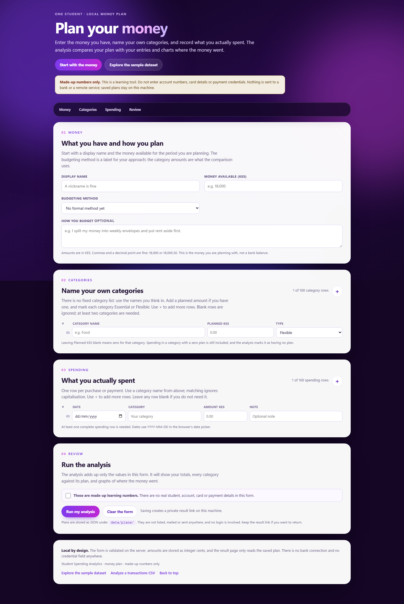

Open `http://127.0.0.1:8000/plan` (or choose **Plan my money** on the dashboard). The
form is an ordinary HTML form with no JavaScript:

1. **Money** — a display name (a nickname is fine), the money available for the period,
   and an optional budgeting method and note. The method is a label for your approach;
   the category amounts are what the comparison uses.
2. **Categories** — name your own categories, in your own words. Each row takes an
   optional planned amount and an **Essential** or **Flexible** flag. There is no fixed
   category list. Blank rows are ignored, and at least two named categories are required.
   The **+** button beside the heading adds rows, from one up to 100; it preserves every
   value you have typed and does not save a plan.
3. **Spending** — one row per purchase or payment: date, one of your category names,
   amount and an optional note. Category matching ignores capitalisation, and entries in
   a category with no planned amount are still included and marked **No plan**. The
   **+** button beside this heading adds rows, from one up to 100, with the same
   preserve-and-do-not-save behaviour.
4. **Review** — confirm the numbers are made up, then select **Run my analysis**.

Amounts accept `2,500`, `2500`, `12 500` and `KES 2500.50`, and are stored as integer
cents. The form starts with one category row and one spending row; the **+** buttons grow
either list to 100. A plan cannot hold more than those limits.

The result page is saved under an unguessable `/plan?plan=p-…` link and shows:

- cards for money available, planned, spent and left;
- plain-language banners for unallocated money, overspending, unplanned spending and
  unspent plan lines;
- a ranked category chart and a grouped **plan next to actual** chart, both inline SVG
  with tooltips and a swipe hint on phones;
- a category table with planned, spent, difference, share and status (**On plan**,
  **Under plan**, **Over plan**, **No plan**, **Not used**, **No activity**);
- an essential-versus-flexible split, the spending entries behind the totals, and the
  budgeting method you chose.

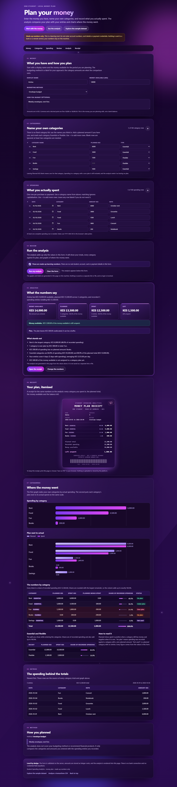

Everything is calculated from the submitted values: totals, shares, the daily average
over the entered date span, and the over-plan and unplanned lists. The page does not
advise on financial products or tell the student what they should spend.

The result is a `303` redirect to the bookmarkable GET page, so a refresh does not save
the plan twice. **Edit as a copy** opens the form prefilled and saves a new plan rather
than overwriting the old one. Plans are JSON files under `data/plans/`, are not listed
anywhere, and are never sent to a remote service. There is no account, login, bank
connection or credential field; the only write endpoints are `POST /upload` and
`POST /plan`.

Keep the result link if you want to return: with no listing or index, the link is the
only way back. To clear saved plans, remove the JSON files in `data/plans/` (the
directory is git-ignored). This is a learning tool for made-up numbers, not a bank
statement or a financial adviser.

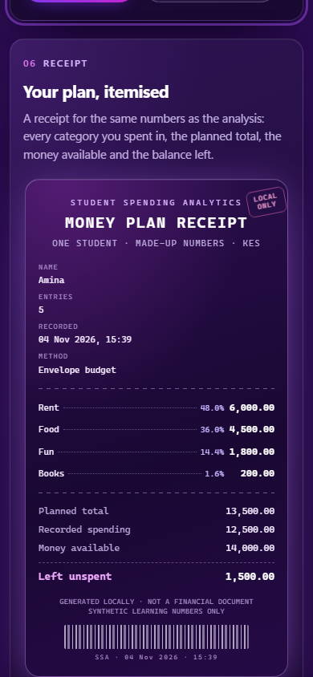

At phone width the cards and table rows stack, and each chart scrolls sideways inside
its own container with a visible hint, so no value is squeezed off the page.

## Upload and analyze a CSV

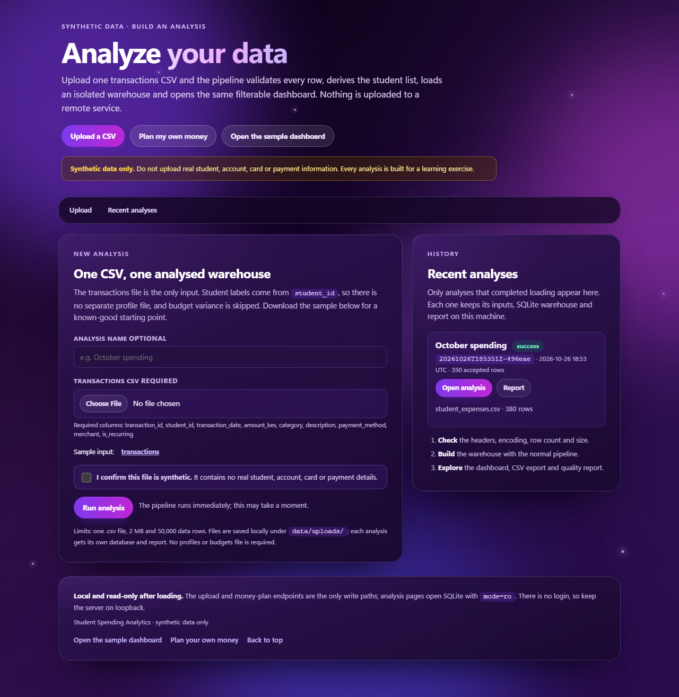

Start the server and open `http://127.0.0.1:8000/upload`. Supply one transactions CSV,
give the analysis an optional name, confirm that the file is synthetic, and select
**Run analysis**. The form links the committed sample transactions file as a known-good
starting point.

The browser sends the file to `POST /upload`. The server validates the multipart form,
writes a canonical copy, and runs the same `run_pipeline` used by the CLI into a
workspace of its own:

```
data/uploads/<analysis_id>/transactions.csv, metadata.json
warehouse/uploads/<analysis_id>.db
reports/uploads/<analysis_id>/spending_report.html
```

No profiles CSV is needed: the student dimension is derived from the distinct
`student_id` values in the transactions. The derived label is the id itself, campus is
`Not provided`, and the unavailable study year and monthly income are stored as `0`.
No budgets file is needed either, so budget variance is skipped and the report says so
instead of showing an empty comparison. The CLI still accepts explicit profiles and
budgets when you want the full model.

The response is a `303` redirect to `/?analysis=<analysis_id>`. Every filter, page,
CSV export and report link on that page carries the id, so the whole view remains
bookmarkable and self-contained. **Recent analyses** on `/upload` lists finished
workspaces, their status and row counts. The committed `warehouse/student_spending.db`
is never modified by an upload.

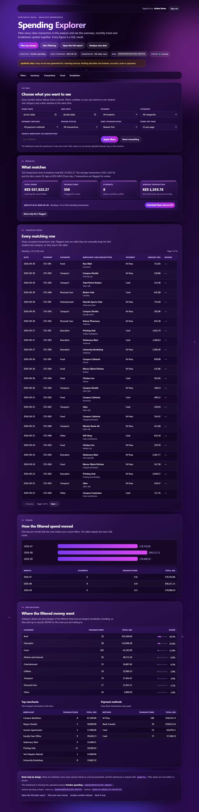

If a data quality check fails, the pipeline exits with code `1` but still writes the
warehouse and report. The analysis opens with a red **Quality alert** banner reporting
how many checks failed, and the rows remain available for review. The full report lists
the individual check results. An unrecoverable pipeline error returns `422`, explains the
problem on the upload page, and removes the partial workspace.

| Limit | Value |
|---|---|
| File type | `.csv` filename, UTF-8 text |
| File size | 2 MB |
| Data rows | 50,000, after a header and at least one non-empty row |
| Analysis name | 80 characters; optional, defaults to "Untitled analysis" |
| Form parts | 12 fields, with no duplicate or unknown field names |

Required columns (extra columns are allowed):

- transactions: `transaction_id, student_id, transaction_date, amount_kes, category,
  description, payment_method, merchant, is_recurring`

A missing column, a non-UTF-8 file, a header-only file or an unconfirmed upload is
rejected before any pipeline work starts. Client filenames are recorded in metadata
only; the file on disk always uses a fixed name inside a generated analysis id.
Uploaded files are saved locally and are never sent to a remote service.

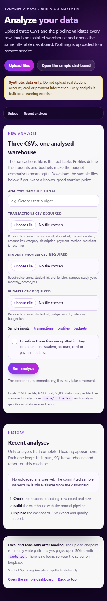

At phone width the form stacks into one column and the history card moves below it, so
neither the input nor the limits are pushed off-screen.

`POST /upload` and `POST /plan` are the only write paths. Requests are checked against
`Origin` and `Sec-Fetch-Site` to block cross-site form posts, and the server keeps the
`same-origin` referrer policy so a real browser sends a verifiable origin while still
not leaking URLs to other sites. Uploads and plans are size-limited, and plan ids are
validated against a strict pattern before a file is read. There is no login, so keep
the server on loopback.

## Dashboard

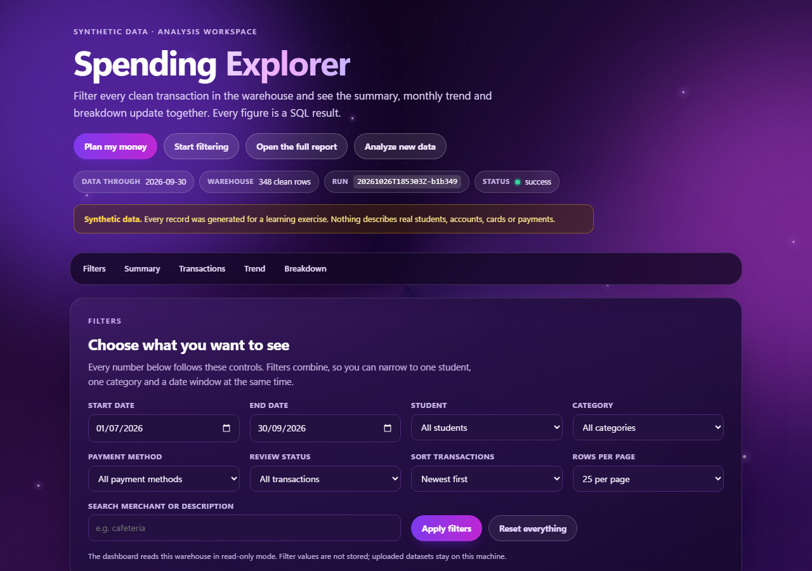

The interactive surface is a local, read-only explorer over the same warehouse:

```powershell
student-spending serve --open
```

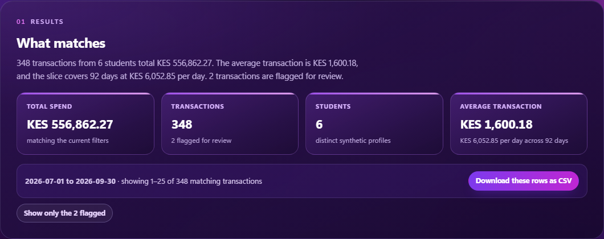

Every control is an ordinary GET form field, so the page needs no JavaScript and
each view has a bookmarkable URL. Applying a filter runs a new parameterised query
and updates the summary, transaction table, monthly trend and breakdown together.

| Control | What it changes |
|---|---|
| start / end date | restricts `transaction_date`; the summary reports the covered day span |
| student / category / payment | optional allow-listed equality filters |
| review status | all transactions, or only rows flagged for review |
| search | case-insensitive `LIKE` over merchant and description, with `%` and `_` matched literally |
| sort | newest, oldest, largest or smallest; the column list is fixed in code |
| rows per page | 25, 50 or 100, with previous/next links and a clamped page number |

The result bar states exactly what matched, the CSV button downloads only those rows,
and a shortcut shows the flagged rows directly. Invalid values (an impossible date, an
unknown student, a tampered sort) are rejected field by field with a visible message
rather than crashing the page or being passed through to SQL.

The server binds to `127.0.0.1` by default, opens SQLite with `mode=ro` **and**
`PRAGMA query_only = ON`, and opens a short-lived connection per request. It sends a
restrictive Content-Security-Policy, `nosniff`, `no-store` and a `same-origin` referrer
policy, escapes all database text into HTML, and prefixes spreadsheet-formula characters
in CSV exports. The dashboard itself is read-only: the only write endpoints are
`POST /upload` (which starts an isolated pipeline run) and `POST /plan` (which saves one
JSON plan). There is no login and the server serves no arbitrary files.

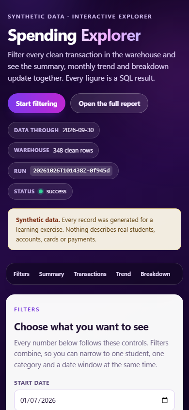

At phone width the controls stack and the tables become labelled cards, so no column is
hidden off-screen. The purple backdrop, reduced-motion handling and print styles are
shared with the report through `theme.py`.

## Report

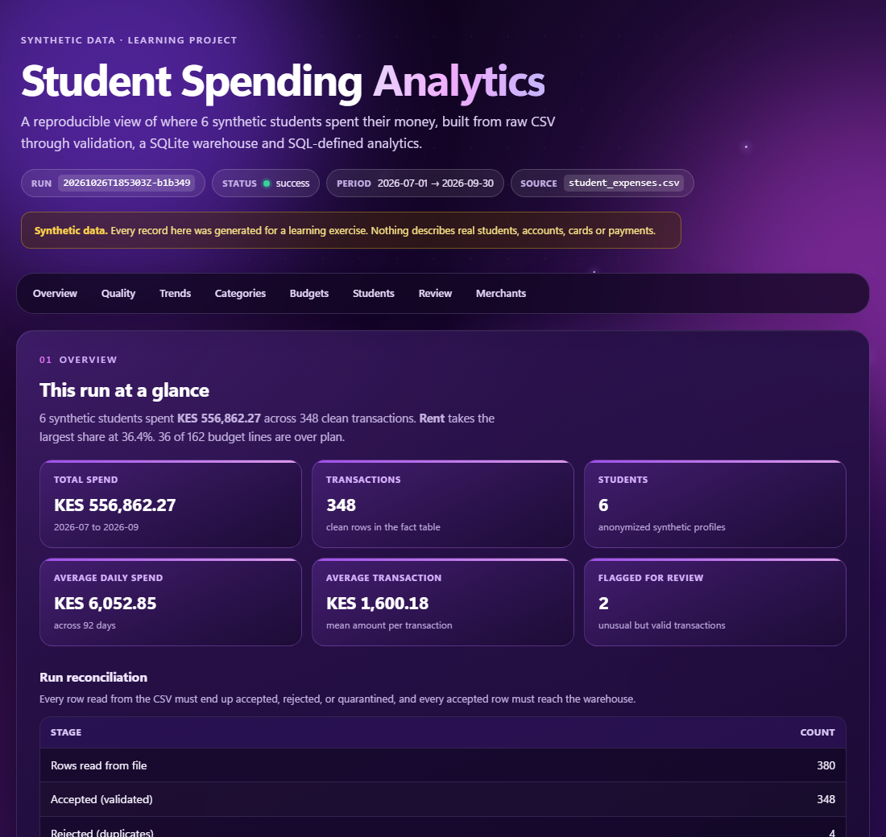

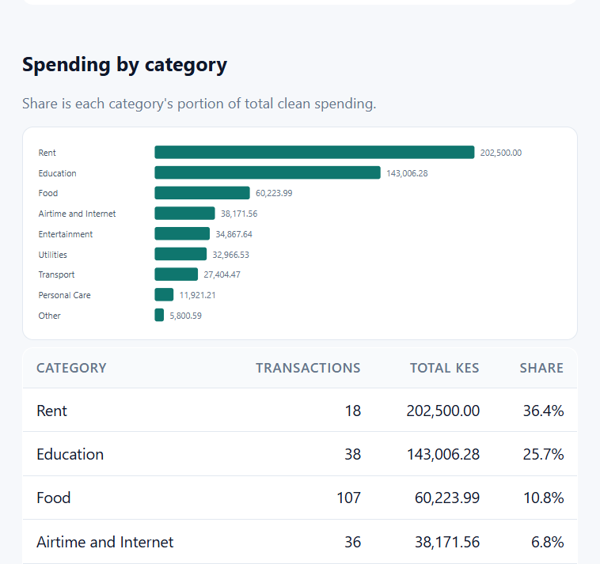

The report and dashboard are regenerated from SQL on every request/run; no figure is
hard-coded. The report is a single self-contained file: an animated purple backdrop,
sticky section navigation, KPI cards, gradient SVG charts and share bars. On narrow
screens tables become labelled cards instead of hiding columns behind a scrollbar.
Animations are disabled under `prefers-reduced-motion`, and the page includes print
styles.

## Project layout

```
student-spending-analytics/
├── .github/workflows/        CI: tests + two pipeline runs on 2 OSes × 2 Pythons
├── data/
│   ├── raw/                  committed synthetic inputs (3 CSV files)
│   ├── uploads/              isolated copies of uploaded analyses (git-ignored)
│   ├── plans/                saved one-student money plans as JSON (git-ignored)
│   ├── quarantine/           generated rejection audit CSVs (git-ignored)
│   └── processed/            reserved for future exports (git-ignored)
├── docs/                     data dictionary, quality policy, learning log
├── reports/                  generated HTML report; uploads/ per analysis (git-ignored)
├── scripts/                  generate_synthetic_data.py, check_env.py
├── sql/                      schema.sql, example_queries.sql
├── src/student_spending/     pipeline, report, platform, dashboard and plan modules
├── tests/                    133 unittest cases
├── warehouse/                generated SQLite database; uploads/ per analysis (git-ignored)
├── logs/                     pipeline.log (git-ignored)
├── pyproject.toml            package metadata, console script, build config
├── CHANGELOG.md              release history
├── LICENSE                   MIT
├── run_pipeline.py           CLI wrapper for running from a checkout
└── run_tests.py              test wrapper
```

## Data model

| Object | Type | Grain / key | Purpose |
|---|---|---|---|
| `students` | dimension | `student_id` | anonymized synthetic profiles |
| `categories` | dimension | `category` | canonical category list + discretionary flag |
| `transactions` | fact | one row per `transaction_id` | clean, validated spending |
| `budgets` | fact | student × month × category | planned spending |
| `transactions_quarantine` | audit | one row per quarantined row per run | rows needing human review |
| `rejected_transactions` | audit | one row per rejected row per run | duplicate copies |
| `pipeline_runs` | metadata | `run_id` | counts, status, timings |
| `data_quality_results` | metadata | run × check | pass/fail evidence |

Money is stored as **integer cents** (`amount_cents`) and exposed as `amount_kes` in
views. Sums therefore never drift through floating-point error.

Analytical views: `v_transactions`, `v_monthly_category`, `v_monthly_student`,
`v_monthly_totals`, `v_category_totals`, `v_weekly_spending`, `v_week_over_week`,
`v_weekday_spending`, `v_daily_spending`, `v_student_totals`, `v_budget_vs_actual`,
`v_flagged_transactions`.

Field-level detail: [docs/DATA_DICTIONARY.md](docs/DATA_DICTIONARY.md).

## Data quality policy

- Invalid rows are **quarantined, not deleted**. They stay in the audit tables and CSV.
- Duplicate `transaction_id` with identical content: keep the first, reject the copies.
- Duplicate `transaction_id` with conflicting content: quarantine **all** copies,
  because there is no evidence which version is true.
- Unknown categories are never silently remapped; they are quarantined.
- Unknown payment methods are mapped to `Other` with a warning (the transaction itself
  is still valid).
- Missing description/merchant is stored as `Not provided` with a warning.
- Anomalies are flagged, never removed: more than 3× the student's own average for that
  category **and** above KES 2,500, with at least 3 historical rows in that
  student/category.

Full rule table, reason codes and review workflow:
[docs/DATA_QUALITY.md](docs/DATA_QUALITY.md).

## Example SQL

```sql
-- Total spend per student
SELECT profile_label, transaction_count, ROUND(total_kes, 2) AS total_kes
FROM v_student_totals
ORDER BY total_kes DESC;

-- Monthly spend by category for one student
SELECT transaction_month, category, ROUND(total_kes, 2) AS total_kes
FROM v_monthly_category
WHERE student_id = 'STU-001'
ORDER BY transaction_month, total_kes DESC;

-- Budget lines that overspent, worst first
SELECT profile_label, budget_month, category,
       ROUND(actual_kes - budget_kes, 2) AS overspend_kes
FROM v_budget_vs_actual
WHERE is_over_budget = 1
ORDER BY overspend_kes DESC;
```

More, including window functions for week-over-week movement:
[sql/example_queries.sql](sql/example_queries.sql).

## Tests

```powershell
python run_tests.py
# or, without the wrapper:
python -m unittest discover -s tests -t . -v
```

133 tests covering: extraction failures and malformed rows, derived and explicit student
dimensions, every validation rule, normalisation, duplicate handling, reconciliation
accounting, idempotent loading, foreign keys and CHECK constraints, analytics totals and
shares, anomaly flagging, all quality checks, end-to-end pipeline runs including rerun
and single-file behaviour, and the web surface: filter composition against hand-written
SQL, literal wildcard and injection attempts, sort/date/allow-list validation, pagination
clamping, HTML escaping, CSV formula guards, report routing, security headers, read-only
enforcement and CLI dispatch.

The money planner adds tests for amount parsing (`2,500`, `KES 2500.50`, `1 000`, invalid
and negative values), draft validation (names, duplicates, unknown spending categories,
dates, bounds, at least two categories and one spending row, synthetic confirmation),
integer-cent analysis (planned/spent/left/unallocated, category statuses, essential and
flexible shares, daily average), JSON storage and reload, rejection of malformed or
tampered plan files, and the web flow: form rendering, adding category and spending rows
while preserving input without saving, both 100-row limits, saving a plan at both
maxima, submission and bookmarkable result, edit-as-copy, validation errors that preserve
input and save nothing, cross-site and
wrong-content-type guards, injected-text escaping, and analysis with zero planned amounts.

The upload platform adds tests for single-CSV multipart validation (missing, duplicate
and unknown fields; wrong extensions; missing headers; header-only and binary files;
size and part limits; the synthetic-data confirmation), derived student labels, isolated
files, database and report per analysis, analysis-aware filter/pagination/export/report
links, two-upload isolation, quality-failure alerts, cleanup after a 422, cross-origin
and `Origin: null` rejection, traversal-resistant analysis ids, fixed sample routes and
escaped analysis names.

## Design decisions

| Decision | Reason |
|---|---|
| Standard library only | No install friction for a learning project; `csv`, `sqlite3`, `decimal`, `hashlib`, `unittest` cover every requirement |
| Money stored as integer cents | `REAL` sums drift; cents make totals exact and comparable |
| `record_hash` on each fact row | Detects changed records without dirty timestamp comparisons; drives insert/update/unchanged counts |
| Upsert instead of truncate-and-reload | Reruns are safe, and corrected upstream records update in place while preserving `first_loaded_at` |
| Views for analytics, Python for orchestration | Definitions live once in SQL; the report and tests query the same objects |
| Quarantine table + CSV | Auditable and reviewable; nothing vanishes silently |
| Validity vs anomaly separated | A large purchase is legitimate but interesting; conflating the two loses data |
| HTML report with inline SVG | Dependency-free, self-contained, and reads only from the database |
| Dashboard on `http.server`, no framework | A read-only explorer needs routing, HTML and SQL, all of which the standard library provides; filters stay as bookmarkable GET state |
| Upload runs the existing pipeline in an isolated workspace | One source of truth for validation, loading and analytics; a bad upload cannot alter the committed warehouse, and each analysis remains reproducible from its saved inputs |
| One CSV for uploads; students derived from transactions | The transaction file already identifies every student, so asking for a profile file was avoidable friction; unknown descriptive fields are stored as unknown instead of invented |
| Budget variance is skipped when no budgets are uploaded | A zero-row budget comparison would look like "all budgets met"; the report states that no plan was provided rather than implying a result |
| Fixed filenames inside a generated analysis id | Client-supplied names never become paths; the strict id pattern makes traversal and ambiguous workspaces impossible |
| Analysis id carried through every link | A filtered view, CSV download and report stay attached to the same warehouse without server-side session state |
| Two-layer upload guard: origin check plus synthetic confirmation | The server rejects cross-site form posts and the submitter explicitly confirms the data is fake; neither is a substitute for authentication, which is why binding stays on loopback by default |
| Read-only SQLite URI plus `query_only` | The dashboard cannot accidentally write, even if a handler is wrong; each request gets its own short-lived connection |
| Fixed sort and filter allow-lists | Untrusted input never becomes SQL text; `LIKE` wildcards are escaped and ordering is chosen from a dict |
| Shared `theme.py` and `components.py` | The report, dashboard and planner use one visual language and one set of escaping/format helpers, so fixes apply to both |
| User-defined category names instead of a fixed list | A student thinks in their own words; a fixed enum would force them to mislabel spending or use "Other" for everything. Duplicates are detected case-insensitively |
| Planner writes JSON, not warehouse tables | It is a per-student worksheet, not a batch fact table; keeping it out of the warehouse preserves the pipeline's reconciliation identities and the sample dataset |
| Plan analysis computes in Python from validated values | The page only reads the saved plan and shows arithmetic on the student's own numbers; it does not claim a statistical or advisory result |
| Random, unguessable plan ids with no listing | There is no login, so the result link is the access token; a directory index would expose every saved plan to anyone on the machine |
| Editable install with a console script | One command to run the pipeline; the `src/` layout also prevents tests from importing the package by accident |
| CI runs the pipeline twice | Proves idempotency on a clean machine, not just in a local wrapper |

## Continuous integration

`.github/workflows/ci.yml` runs on Ubuntu and Windows with Python 3.12 and 3.13:

1. install the package in editable mode,
2. run the full test suite,
3. build the warehouse with `student-spending --full-refresh`,
4. rerun without a refresh to prove the load is idempotent,
5. upload the HTML report and audit CSV as a build artefact.

The workflow uses only the committed synthetic data, so it needs no secrets or
external services.

## Known limitations

- Data is synthetic; the category mix and budgets are generated, so the insights are
  illustrative rather than behavioural findings.
- Batch-only, single-file ingestion with full re-read each run. No watermarks.
- SQLite is single-writer; not suitable for concurrent multi-user loading.
- Dates are ISO strings with no time component; no timezone or late-arriving-record
  handling beyond upsert.
- The anomaly rule is a documented heuristic, not a statistical outlier model.
- Quarantine records accumulate per run; there is no resolution UI or "cleared" state.
- The dashboard is single-user and loopback-only. It has no login, saved views or
  concurrent-writer coordination; it is a viewer for a batch-built warehouse.
- Uploads run synchronously inside the request, so a large CSV keeps that request open
  until the pipeline finishes. There is no queue, progress stream, cancellation,
  retention policy or delete button; analysis directories accumulate until removed by
  hand. Loading is serialised by a process-wide lock, so two uploads do not write at once.
- Uploads derive one student per `student_id`. Names, campus, study year and income are
  not collected, and uploads have no budget plan, so the report shows actual spending
  without variance. The CLI remains the way to supply those dimensions.
- Upload validation checks structure (filename, encoding, headers, size and row count),
  not the meaning of every value. Semantic problems are handled by the normal validation
  and quality stages and appear as quarantined rows or a quality alert.
- Dashboard filters are applied on submit rather than live-updating, and search is a
  substring match over two text columns, not a ranked full-text search.
- The money planner is a single-student worksheet with no history, month switching or
  comparison between periods. It does not import the sample warehouse or an uploaded
  CSV, and it has no recurring-entry or currency-conversion support; all amounts are KES.
- The planner form starts with one category row and one spending row, each extendable
  to 100 with its **+** button. Every submission creates a new saved plan, including
  **Edit as a copy**. There is no in-place update, delete button, retention policy or
  list of saved plans; remove files under `data/plans/` by hand.
- Saved plans are unencrypted JSON containing the display name, amounts, categories and
  notes. There is no login: anyone who can reach the server or read the disk and knows a
  plan id can read that plan. That is acceptable only for made-up numbers on loopback.
- The plan analysis describes the entered numbers (totals, shares, averages and plan
  status). It is not a forecast, credit assessment or financial advice.
- No authentication or encryption. That is acceptable only because the data is fake and
  stays on the local disk; real financial data would require both, plus a deletion and
  retention policy for uploaded files and saved plans.

## Future improvements

- Incremental extraction (file watermark + `ingested_at`) and a scheduler.
- Run uploads as a background job with progress, cancellation and a retention/delete
  policy for analysis workspaces.
- Resolve quarantined rows through a reviewed fixes file with lineage back to the run.
- dbt-style transformation tests or a data quality framework once the SQL grows.
- Postgres or DuckDB when data outgrows a single SQLite file.
- Add saved filter views and a small JSON endpoint over the same validated filters.
- Let the planner import a student's own rows from the dashboard or a CSV, add monthly
  periods and recurring entries, and export the analysis.
- Add a plan list with an explicit delete/retention action once the planner has a real
  authentication story.
- Publish tagged releases once the input contract has stayed stable across a few runs.

## Project log

Phase-by-phase notes, decisions and the bugs hit during development:
[docs/LEARNING_LOG.md](docs/LEARNING_LOG.md). Release history:
[CHANGELOG.md](CHANGELOG.md).

## License

[MIT](LICENSE). The committed dataset in `data/raw/` was generated by this project
and is covered by the same licence; it does not describe real students, accounts or
payments.
