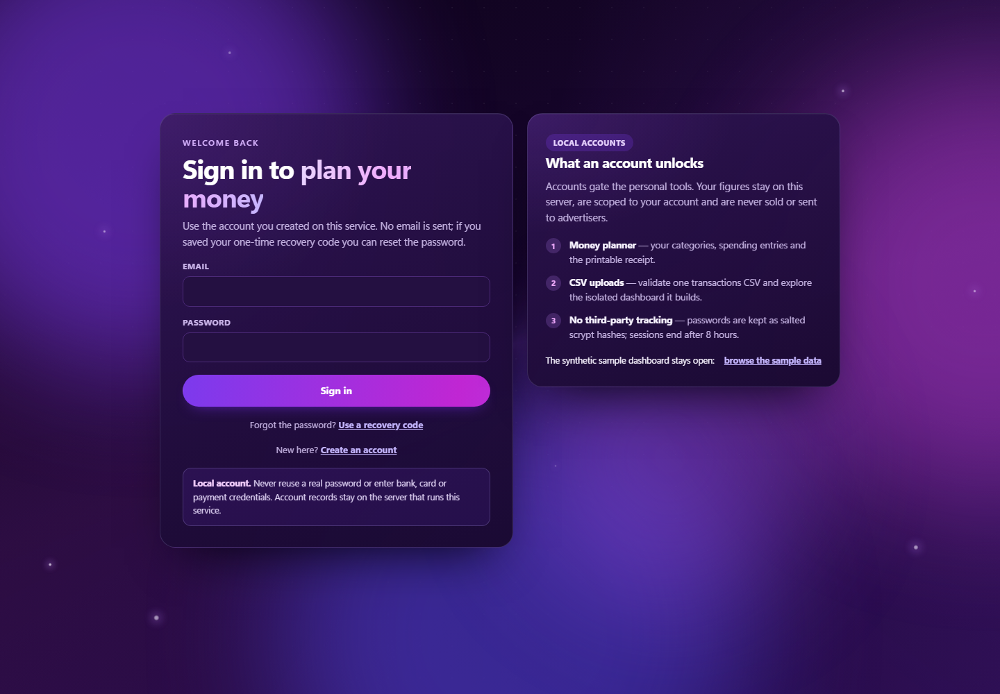
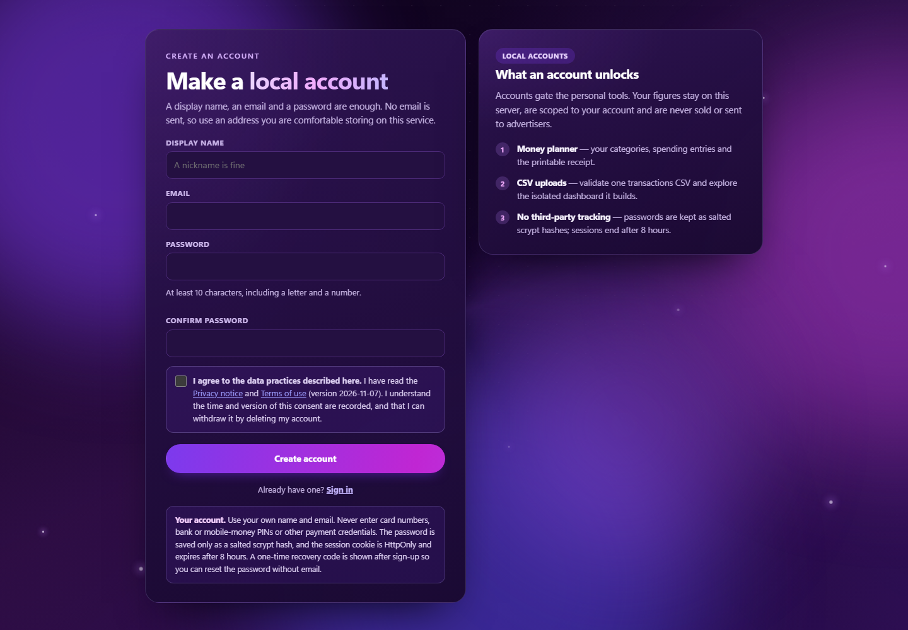
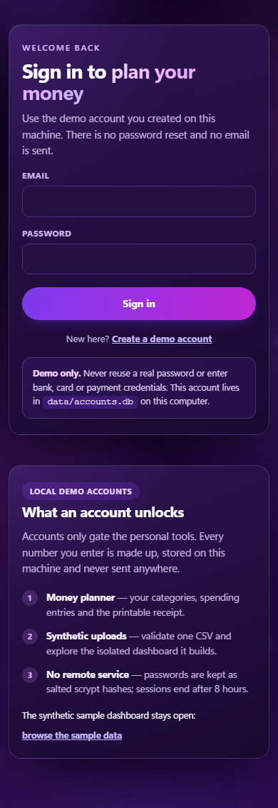
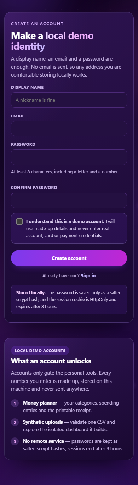
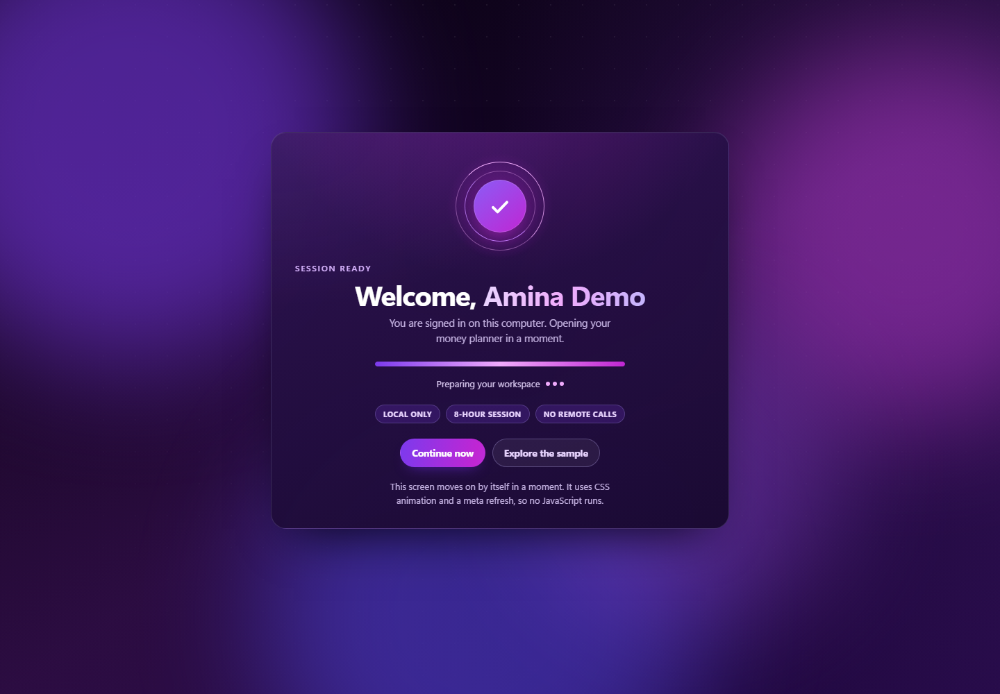
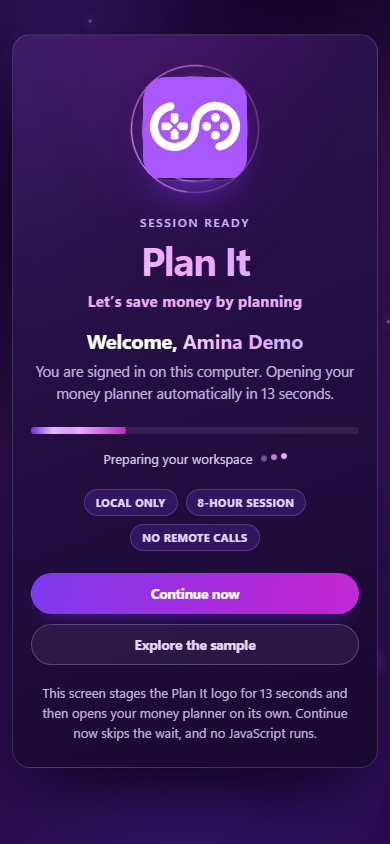
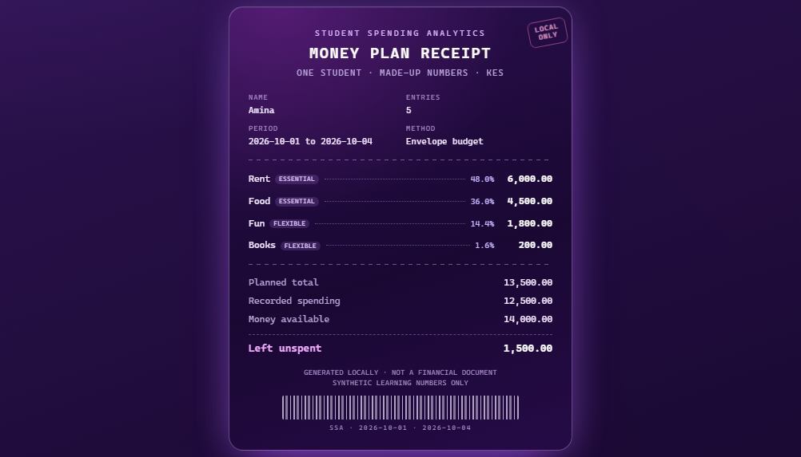

# Student Spending Analytics

A local data engineering pipeline that turns raw, deliberately messy student expense
records into a validated SQLite warehouse, reproducible analytics, automated data
quality checks, an HTML report, and a filterable dashboard. The same server accepts a
transactions CSV, derives the student list, runs the pipeline into an isolated workspace,
and opens the analysis without touching the committed warehouse.

It also includes a per-student money planner: a student enters the money they have, names
their own categories, records planned and actual amounts, and gets an in-page analysis
with planned-versus-actual totals, exact category shares, inline SVG charts and a
printable receipt. The planner is local, needs no JavaScript and never asks for bank or
card credentials.

A local demo account unlocks the planner and the CSV upload. Signing up needs only a
display name, a made-up email and a password; the sample dashboard and report stay open
without signing in.

Built as a learning project: the code is intentionally module-by-module and documented
so the reasoning behind each stage is visible.

> **Data disclaimer.** Every record in this repository is synthetic and generated by
> `src/student_spending/synthetic.py`. Nothing here describes real students, accounts,
> cards or payments. Figures in this README are the actual output of the pipeline on
> the committed dataset, not illustrative placeholders.

## What it answers

- How much does each student spend per month and in total?
- Which categories take the largest share of the budget?
- What is the average daily and average per-transaction spend?
- Which spending days are heaviest, by day of week?
- Which student/month/category lines exceed the planned budget, and by how much?
- How does week-over-week spending change?
- Which transactions are unusual enough to investigate?
- How consistent are the numbers between the raw file, the warehouse and the report?

For one student's own numbers, the money planner answers:

- How much of the money available is planned, spent, left and unallocated?
- Which of my own categories are over plan, under plan, unplanned or unused?
- What share of spending went to each category, and to essential versus flexible needs?
- What does the planned-versus-actual comparison look like as a graph?
- What is the average daily spend across the dates I entered?

## Architecture

```
data/raw/*.csv
      │
      ├── extract.py      read + structurally parse rows (never repairs data)
      │
      ├── validate.py     row rules → normalisation → duplicate policy
      │        │
      │        ├── accepted ──► database.py + load.py ──► warehouse/student_spending.db
      │        ├── rejected ──► rejected_transactions   (duplicates)
      │        └── quarantined ► transactions_quarantine + CSV audit trail
      │
      ├── analytics.py    flag anomalies, run analytical queries over SQL views
      │
      ├── quality.py      12 automated checks, including reconciliation
      │                   (11 for a single-file upload without budgets)
      │
      ├── report.py       reports/spending_report.html (charts + tables from SQL)
      │
      ├── web.py          student-spending serve → dashboard + upload + money plan
      ├── accounts.py     local demo accounts, scrypt hashes and sessions (data/accounts.db)
      ├── platform.py     validate one upload, run it in an isolated workspace
      └── personal.py     validate one student money plan and analyse it in the page
```

The report and the dashboard read the same SQL views; neither computes its own totals.
The money planner is separate: it analyses only the values the student submits and
renders the result in the same page, so it never writes to the warehouse or to disk.
Demo accounts live in their own small database, apart from the warehouse.

Every row read from the CSV must be accounted for:

```
rows_read = accepted + rejected + quarantined
accepted  = inserted + updated + unchanged
```

Both identities are asserted on every run by the `reconciliation_counts` check and by
the integration tests.

## Install

Python 3.12+ (3.13 tested) with its bundled SQLite (3.35+). There are
**no third-party runtime dependencies**; pip fetches `setuptools` only to build
the package.

```powershell
cd C:\Users\PC\Documents\Qoder\2026-10-26\ef1e6962\student-spending-analytics
py -3.13 -m venv .venv
.\.venv\Scripts\Activate.ps1
python -m pip install -e .
```

Git Bash equivalents: `source .venv/Scripts/activate` and the same pip command.
`python scripts/check_env.py` verifies the interpreter, SQLite version and active
virtual environment.

## Quick start

```powershell
python scripts\generate_synthetic_data.py     # writes data/raw/*.csv
student-spending --full-refresh               # deletes the warehouse, then rebuilds it
python run_tests.py                           # 158 tests
start reports\spending_report.html
student-spending serve --open                 # local server; blocks until Ctrl+C
```

Open `http://127.0.0.1:8000/` for the sample dashboard,
`http://127.0.0.1:8000/plan` to plan one student's money, or
`http://127.0.0.1:8000/upload` to analyze a synthetic transactions CSV. The planner and
upload ask you to sign in first; create a local demo account at
`http://127.0.0.1:8000/signup` with any made-up email.

Omit `--full-refresh` to rerun against the existing warehouse. Because loading is
upsert-based and change-detected, a rerun inserts nothing and updates nothing.

`student-spending`, `python -m student_spending` and `python run_pipeline.py` are
equivalent entry points; `student-spending --version` reports the installed version.
Run the console script from the project directory so the default `data/`, `sql/`
and `warehouse/` paths resolve.

## Command line

```
student-spending [--transactions PATH] [--profiles PATH] [--budgets PATH]
                 [--db PATH] [--full-refresh] [--log-level LEVEL]

student-spending serve [--db PATH] [--host ADDR] [--port N] [--open]
```

| Option | Default | Purpose |
|---|---|---|
| `--transactions` | `data/raw/student_expenses.csv` | raw transaction input |
| `--profiles` | `data/raw/student_profiles.csv` | student dimension input |
| `--budgets` | `data/raw/student_budgets.csv` | planned-spend input |
| `--db` | `warehouse/student_spending.db` | SQLite warehouse location |
| `--full-refresh` | off | delete the warehouse file first (destructive) |
| `--log-level` | `INFO` | console log level |

Exit codes: `0` success, `1` a data quality check failed, `2` a pipeline error
(missing or invalid input), `3` an unexpected error. Every code is exercised by
the integration tests. The full run log is also written to `logs/pipeline.log`.

### Dashboard options

| Option | Default | Purpose |
|---|---|---|
| `--db` | `warehouse/student_spending.db` | warehouse to read (must already exist) |
| `--host` | `127.0.0.1` | bind address; loopback keeps the dashboard local |
| `--port` | `8000` | port to bind; use `0` to pick a free port |
| `--open` | off | open the dashboard in the default browser |

`serve` hosts the sample dashboard at `/`, the CSV upload at `/upload` and the
one-student money planner at `/plan`, plus the account pages `/signup`, `/login`,
`/logout` and the post-sign-in `/welcome` screen. It refuses to start when the warehouse is missing, unreadable or empty, and
prints the rebuild command instead of serving a broken page. Stop it with Ctrl+C.
Demo accounts are stored in `data/accounts.db`, created on first use and separate from
the warehouse.

## Local demo accounts



The sample dashboard, report and CSV export stay public. The two personal tools — the
money planner at `/plan` and the CSV upload at `/upload` — sit behind a local demo
account, so the workspace behaves like a real product without collecting anything real.
The dashboard shows **Demo mode · sample dashboard** with **Sign in** and
**Create account** links; after signing in it shows your display name and a **Sign out**
button on every page.

- `/signup` creates an account from a display name, a made-up email and a password,
  then signs you in and returns you to the page you originally asked for.
- `/login` starts an eight-hour session and honours a same-site `next` path.
- `/welcome` is a 13-second branded loading screen between signing in and the destination
  page.
- `/logout` is a POST form that deletes the session and clears the cookie.

Accounts live in `data/accounts.db`, a small local SQLite file that is git-ignored.
Passwords are hashed with `hashlib.scrypt` (N=16384, r=8, p=1, a random 16-byte salt)
and compared with `hmac.compare_digest`; the stored value has the form
`scrypt$16384$8$1$<salt>$<digest>`, and the plaintext is never written. Session tokens
are random 32-byte URL-safe strings, but the database keeps only their SHA-256 digest,
so a copy of the file cannot be replayed as a login cookie. The cookie is `HttpOnly`
and `SameSite=Strict`, no JavaScript reads it, and it expires after eight hours. Eight
failed sign-ins from one address within five minutes return `429` with `Retry-After`
instead of allowing unlimited guesses. A failed login says only that the email and
password did not match, and an unknown email is checked against a dummy hash so it does
not answer measurably faster than a wrong password.

Sign-up asks you to confirm that every value is made up. Do not enter a real student
identity, a real email password or any bank, card or payment credentials: this is a
teaching demo, not an identity service. It runs on loopback HTTP, so the cookie is not
marked `Secure`; the server warns when it is bound beyond loopback because these demo
accounts are not internet-grade.



At phone width the auth card and its explainer stack into a single column, with the
form first.





### The sign-in loading screen

Signing in or creating an account lands on `/welcome` rather than jumping straight to the
destination. The screen stages the **Plan It** brand — the logo in an animated tile, the
wordmark and the slogan *Let's save money by planning* — above the signed-in name and the
destination wording. Rings orbit the logo, the tile floats, and a linear progress bar fills
for 13 seconds before the page moves on. The redirect is
`<meta http-equiv="refresh">`, so it works under the strict no-JavaScript CSP; a
**Continue now** button is there for anyone who does not want to wait. The page is gated
like the tools, so an anonymous visit redirects to sign-in, and an unsafe `next` value
falls back to `/plan`.



At phone width the card tightens, the buttons go full width, and the same 13-second
countdown runs.



The logo is a 21 KB JPEG served from `/assets/plan-it-logo.jpg`, a public same-origin asset
so the browser can cache it and the HTML stays small. It is the only image the CSP allows
alongside `data:`. The rest of the dashboard keeps its existing page titles and labels;
the Plan It identity is currently applied to this screen.

All motion is CSS-only. Buttons across the platform — primary and ghost links, sign-out,
add-row **+**, and the file picker — lift on hover, press down on click, and run a light
sweep across their surface; the primary button also slides its gradient. Every one of
those transitions is disabled under `prefers-reduced-motion: reduce`, where the logo, rings
and progress bar render in their final state.

## What a run produces (verified output of this repository)

```
Run 20261026T092649Z-53a078
Rows read .......... 380
Accepted ........... 348 (inserted 348, updated 0, unchanged 0)
Rejected ........... 4 duplicate row(s)
Quarantined ........ 28 row(s) held for review
Flagged anomalies .. 2
Quality checks ..... all passed
```

The immediately following run reported `inserted 0, updated 0, unchanged 348` with the
same totals — the pipeline is idempotent.

### Monthly spending

| Month | Transactions | Total KES |
|---|---:|---:|
| 2026-07 | 116 | 178,703.06 |
| 2026-08 | 117 | 199,251.11 |
| 2026-09 | 115 | 178,908.10 |

Average daily spend across 92 days: **KES 6,052.85**. Average transaction:
**KES 1,600.18**.

### Category share

| Category | Transactions | Total KES | Share |
|---|---:|---:|---:|
| Rent | 18 | 202,500.00 | 36.36% |
| Education | 38 | 143,006.28 | 25.68% |
| Food | 107 | 60,223.99 | 10.81% |
| Airtime and Internet | 36 | 38,171.56 | 6.85% |
| Entertainment | 25 | 34,867.64 | 6.26% |
| Utilities | 18 | 32,966.53 | 5.92% |
| Transport | 79 | 27,404.47 | 4.92% |
| Personal Care | 17 | 11,921.21 | 2.14% |
| Other | 10 | 5,800.59 | 1.04% |

### Budget versus actual

162 budget lines, of which **36 are over budget**. Planned total KES 650,450.00 versus
actual KES 556,862.27. Largest overruns:

| Profile | Month | Category | Budget | Actual | Over by |
|---|---|---|---:|---:|---:|
| Profile A | 2026-09 | Food | 2,200.00 | 3,688.47 | 1,488.47 |
| Profile C | 2026-08 | Entertainment | 1,350.00 | 2,453.66 | 1,103.66 |
| Profile B | 2026-08 | Airtime and Internet | 1,550.00 | 2,206.78 | 656.78 |

### Flagged for investigation

| Date | Profile | Category | Amount KES | Why |
|---|---|---|---:|---|
| 2026-08-12 | Profile C | Education | 24,000.00 | 4.0x the student's average Education spend (average KES 6,021.22) |
| 2026-09-18 | Profile E | Education | 18,500.00 | 4.0x the student's average Education spend (average KES 4,578.20) |

These are valid transactions, not errors. They are flagged and kept.

### Rejected and quarantined rows

| Reason code | Rows | Outcome |
|---|---:|---|
| DUPLICATE_CONFLICT | 6 | quarantined |
| MISSING_REQUIRED_FIELD | 5 | quarantined |
| INVALID_DATE | 4 | quarantined |
| UNEXPECTED_CATEGORY | 3 | quarantined |
| NON_POSITIVE_AMOUNT | 3 | quarantined |
| MALFORMED_ROW | 3 | quarantined |
| UNKNOWN_STUDENT | 2 | quarantined |
| INVALID_AMOUNT | 1 | quarantined |
| DATE_IN_FUTURE | 1 | quarantined |
| DUPLICATE_IDENTICAL | 4 | rejected |

Every rejected or quarantined row is written to
`data/quarantine/rejections_<run_id>.csv` and to the warehouse audit tables.

## Plan your own money


Open `http://127.0.0.1:8000/plan` (or choose **Plan my money** on the dashboard). The
form is an ordinary HTML form with no JavaScript:

1. **Money** — a display name (a nickname is fine), the money available for the period,
   and an optional budgeting method and note. The method is a label for your approach;
   the category amounts are what the comparison uses.
2. **Categories** — name your own categories, in your own words. Each row takes an
   optional planned amount and an **Essential** or **Flexible** flag. There is no fixed
   category list. Blank rows are ignored, and at least two named categories are required.
   The **+** button under the list adds rows, from one up to 100; it preserves every
   value you have typed and does not save a plan.
3. **Spending** — one row per purchase or payment: date, one of your category names,
   amount and an optional note. Category matching ignores capitalisation, and entries in
   a category with no planned amount are still included and marked **No plan**. The
   **+** button under this list adds rows, from one up to 100, with the same
   preserve-and-do-not-save behaviour.
4. **Review** — confirm the numbers are made up, then select **Run my analysis**.

Amounts accept `2,500`, `2500`, `12 500` and `KES 2500.50`, and are stored as integer
cents. The form starts with one category row and one spending row; the **+** buttons grow
either list to 100. A plan cannot hold more than those limits.

Adding a row is seamless with no JavaScript. The **+** control sits in a bar under each
list. Pressing it posts the whole draft back to `/plan`, and the server re-renders the
form with one more row: every value you typed is still there, the page lands instantly at
the end of that list, and the fresh row pops in with a short 0.26-second fade-and-lift.
The landing itself never glides, so the row and the **+** button are in view as soon as
the page paints. Nothing is validated or saved on this round-trip.

Selecting **Run my analysis** keeps you on `/plan`: the page returns with every entered
value still in the form and the analysis inserted below it at `#analysis`. There is no
redirect, no saved plan, no result link and no separate file. The analysis shows:

- cards for money available, planned, spent and left;
- plain-language banners for unallocated money, overspending, unplanned spending and
  unspent plan lines;
- a ranked category chart and a grouped **plan next to actual** chart, both inline SVG
  with tooltips and a swipe hint on phones;
- a category table with planned, spent, difference, share and status (**On plan**,
  **Under plan**, **Over plan**, **No plan**, **Not used**, **No activity**);
- an essential-versus-flexible split, the spending entries behind the totals, and the
  budgeting method you chose;
- a receipt summary directly below the analysis, with each spent-in category, its share,
  the planned total, the money available and the balance left, ready to print or save as
  PDF from the browser. **Open the receipt** jumps straight to it.




Everything is calculated from the submitted values: totals, shares, the daily average
over the entered date span, and the over-plan and unplanned lists. The page does not
advise on financial products or tell the student what they should spend. The graphs are
generated locally as inline SVG; no chart service, remote font or third-party request is
involved.

Percentages name their denominator in the copy: shares in the category tables are of
**recorded spending**, while the planned and spent cards are of the **money available**.
Display shares use the largest-remainder method on the planner, dashboard breakdown and
report, so one-decimal values add up to exactly 100.0% instead of drifting to 100.1%
when several categories are equal.

Because the plan itself is not stored, there is no link to keep and no file to clean up.
Adjust any value and run the analysis again; the page always reflects the form in front
of you. The account is only a gate: it is needed to open `/plan`, but the plan is still
analysed in the response and nothing beyond the account row is saved. There is no bank
connection or credential field anywhere; the write paths are `POST /upload`, `POST /plan`
and the three account forms.


At phone width the cards and table rows stack, each chart scrolls sideways inside its own
container with a visible hint, and the receipt switches to a single-column summary, so no
value is squeezed off the page. The planner shares the animated dark-purple theme with
the report: motion stops under `prefers-reduced-motion`, and the print stylesheet turns
the panels and receipt white for paper or PDF.

## Upload and analyze a CSV


Start the server and open `http://127.0.0.1:8000/upload`. Supply one transactions CSV,
give the analysis an optional name, confirm that the file is synthetic, and select
**Run analysis**. The form links the committed sample transactions file as a known-good
starting point.

The browser sends the file to `POST /upload`. The server validates the multipart form,
writes a canonical copy, and runs the same `run_pipeline` used by the CLI into a
workspace of its own:

```
data/uploads/<analysis_id>/transactions.csv, metadata.json
warehouse/uploads/<analysis_id>.db
reports/uploads/<analysis_id>/spending_report.html
```

No profiles CSV is needed: the student dimension is derived from the distinct
`student_id` values in the transactions. The derived label is the id itself, campus is
`Not provided`, and the unavailable study year and monthly income are stored as `0`.
No budgets file is needed either, so budget variance is skipped and the report says so
instead of showing an empty comparison. The CLI still accepts explicit profiles and
budgets when you want the full model.

The response is a `303` redirect to `/?analysis=<analysis_id>`. Every filter, page,
CSV export and report link on that page carries the id, so the whole view remains
bookmarkable and self-contained. **Recent analyses** on `/upload` lists finished
workspaces, their status and row counts. The committed `warehouse/student_spending.db`
is never modified by an upload.


If a data quality check fails, the pipeline exits with code `1` but still writes the
warehouse and report. The analysis opens with a red **Quality alert** banner reporting
how many checks failed, and the rows remain available for review. The full report lists
the individual check results. An unrecoverable pipeline error returns `422`, explains the
problem on the upload page, and removes the partial workspace.

| Limit | Value |
|---|---|
| File type | `.csv` filename, UTF-8 text |
| File size | 2 MB |
| Data rows | 50,000, after a header and at least one non-empty row |
| Analysis name | 80 characters; optional, defaults to "Untitled analysis" |
| Form parts | 12 fields, with no duplicate or unknown field names |

Required columns (extra columns are allowed):

- transactions: `transaction_id, student_id, transaction_date, amount_kes, category,
  description, payment_method, merchant, is_recurring`

A missing column, a non-UTF-8 file, a header-only file or an unconfirmed upload is
rejected before any pipeline work starts. Client filenames are recorded in metadata
only; the file on disk always uses a fixed name inside a generated analysis id.
Uploaded files are saved locally and are never sent to a remote service.


At phone width the form stacks into one column and the history card moves below it, so
neither the input nor the limits are pushed off-screen.

`POST /upload`, `POST /plan`, `POST /login`, `POST /signup` and `POST /logout` are the
write paths. Every one is checked against `Origin` and `Sec-Fetch-Site` to block
cross-site form posts, and the server keeps the `same-origin` referrer policy so a real
browser sends a verifiable origin while still not leaking URLs to other sites. Uploads,
plans and account forms are size-limited, and the planner keeps no plan ids or files.
The upload and planner pages require a demo session; the sample dashboard stays public.
Keep the server on loopback, because these demo accounts are not internet-grade.

## Dashboard


The interactive surface is a local, read-only explorer over the same warehouse:

```powershell
student-spending serve --open
```


Every control is an ordinary GET form field, so the page needs no JavaScript and
each view has a bookmarkable URL. Applying a filter runs a new parameterised query
and updates the summary, transaction table, monthly trend and breakdown together.

| Control | What it changes |
|---|---|
| start / end date | restricts `transaction_date`; the summary reports the covered day span |
| student / category / payment | optional allow-listed equality filters |
| review status | all transactions, or only rows flagged for review |
| search | case-insensitive `LIKE` over merchant and description, with `%` and `_` matched literally |
| sort | newest, oldest, largest or smallest; the column list is fixed in code |
| rows per page | 25, 50 or 100, with previous/next links and a clamped page number |

The result bar states exactly what matched, the CSV button downloads only those rows,
and a shortcut shows the flagged rows directly. Invalid values (an impossible date, an
unknown student, a tampered sort) are rejected field by field with a visible message
rather than crashing the page or being passed through to SQL.

The server binds to `127.0.0.1` by default, opens SQLite with `mode=ro` **and**
`PRAGMA query_only = ON`, and opens a short-lived connection per request. It sends a
restrictive Content-Security-Policy, `nosniff`, `no-store` and a `same-origin` referrer
policy, escapes all database text into HTML, and prefixes spreadsheet-formula characters
in CSV exports. The dashboard itself is read-only: the write endpoints are
`POST /upload` (which starts an isolated pipeline run), `POST /plan` (which analyses a
submitted plan and writes only the response) and the account routes that create
sessions. The server serves no arbitrary files.


At phone width the controls stack and the tables become labelled cards, so no column is
hidden off-screen. The purple backdrop, reduced-motion handling and print styles are
shared with the report through `theme.py`.

## Report


The report and dashboard are regenerated from SQL on every request/run; no figure is
hard-coded. The report is a single self-contained file: an animated purple backdrop,
sticky section navigation, KPI cards, gradient SVG charts and share bars. On narrow
screens tables become labelled cards instead of hiding columns behind a scrollbar.
Animations are disabled under `prefers-reduced-motion`, and the page includes print
styles.

## Project layout

```
student-spending-analytics/
├── .github/workflows/        CI: tests + two pipeline runs on 2 OSes × 2 Pythons
├── data/
│   ├── raw/                  committed synthetic inputs (3 CSV files)
│   ├── uploads/              isolated copies of uploaded analyses (git-ignored)
│   ├── quarantine/           generated rejection audit CSVs (git-ignored)
│   ├── processed/            reserved for future exports (git-ignored)
│   └── accounts.db           local demo accounts and sessions (git-ignored)
├── docs/                     data dictionary, quality policy, learning log
├── reports/                  generated HTML report; uploads/ per analysis (git-ignored)
├── scripts/                  generate_synthetic_data.py, check_env.py
├── sql/                      schema.sql, example_queries.sql
├── src/student_spending/     pipeline, report, platform, accounts, dashboard and plan modules
│   └── assets/               plan-it-logo.jpg served at /assets/plan-it-logo.jpg
├── tests/                    158 unittest cases
├── warehouse/                generated SQLite database; uploads/ per analysis (git-ignored)
├── logs/                     pipeline.log (git-ignored)
├── pyproject.toml            package metadata, console script, build config
├── CHANGELOG.md              release history
├── LICENSE                   MIT
├── run_pipeline.py           CLI wrapper for running from a checkout
└── run_tests.py              test wrapper
```

## Data model

| Object | Type | Grain / key | Purpose |
|---|---|---|---|
| `students` | dimension | `student_id` | anonymized synthetic profiles |
| `categories` | dimension | `category` | canonical category list + discretionary flag |
| `transactions` | fact | one row per `transaction_id` | clean, validated spending |
| `budgets` | fact | student × month × category | planned spending |
| `transactions_quarantine` | audit | one row per quarantined row per run | rows needing human review |
| `rejected_transactions` | audit | one row per rejected row per run | duplicate copies |
| `pipeline_runs` | metadata | `run_id` | counts, status, timings |
| `data_quality_results` | metadata | run × check | pass/fail evidence |

Money is stored as **integer cents** (`amount_cents`) and exposed as `amount_kes` in
views. Sums therefore never drift through floating-point error.

Analytical views: `v_transactions`, `v_monthly_category`, `v_monthly_student`,
`v_monthly_totals`, `v_category_totals`, `v_weekly_spending`, `v_week_over_week`,
`v_weekday_spending`, `v_daily_spending`, `v_student_totals`, `v_budget_vs_actual`,
`v_flagged_transactions`.

Field-level detail: [docs/DATA_DICTIONARY.md](docs/DATA_DICTIONARY.md).

## Data quality policy

- Invalid rows are **quarantined, not deleted**. They stay in the audit tables and CSV.
- Duplicate `transaction_id` with identical content: keep the first, reject the copies.
- Duplicate `transaction_id` with conflicting content: quarantine **all** copies,
  because there is no evidence which version is true.
- Unknown categories are never silently remapped; they are quarantined.
- Unknown payment methods are mapped to `Other` with a warning (the transaction itself
  is still valid).
- Missing description/merchant is stored as `Not provided` with a warning.
- Anomalies are flagged, never removed: more than 3× the student's own average for that
  category **and** above KES 2,500, with at least 3 historical rows in that
  student/category.

Full rule table, reason codes and review workflow:
[docs/DATA_QUALITY.md](docs/DATA_QUALITY.md).

## Example SQL

```sql
-- Total spend per student
SELECT profile_label, transaction_count, ROUND(total_kes, 2) AS total_kes
FROM v_student_totals
ORDER BY total_kes DESC;

-- Monthly spend by category for one student
SELECT transaction_month, category, ROUND(total_kes, 2) AS total_kes
FROM v_monthly_category
WHERE student_id = 'STU-001'
ORDER BY transaction_month, total_kes DESC;

-- Budget lines that overspent, worst first
SELECT profile_label, budget_month, category,
       ROUND(actual_kes - budget_kes, 2) AS overspend_kes
FROM v_budget_vs_actual
WHERE is_over_budget = 1
ORDER BY overspend_kes DESC;
```

More, including window functions for week-over-week movement:
[sql/example_queries.sql](sql/example_queries.sql).

## Tests

```powershell
python run_tests.py
# or, without the wrapper:
python -m unittest discover -s tests -t . -v
```

158 tests covering: extraction failures and malformed rows, derived and explicit student
dimensions, every validation rule, normalisation, duplicate handling, reconciliation
accounting, idempotent loading, foreign keys and CHECK constraints, analytics totals and
shares, anomaly flagging, all quality checks, end-to-end pipeline runs including rerun
and single-file behaviour, and the web surface: filter composition against hand-written
SQL, literal wildcard and injection attempts, sort/date/allow-list validation, pagination
clamping, HTML escaping, CSV formula guards, report routing, security headers, read-only
enforcement and CLI dispatch.

The money planner adds tests for amount parsing (`2,500`, `KES 2500.50`, `1 000`, invalid
and negative values), draft validation (names, duplicates, unknown spending categories,
dates, bounds, at least two categories and one spending row, synthetic confirmation),
integer-cent analysis (planned/spent/left/unallocated, category statuses, essential and
flexible shares, daily average), and the web flow: form rendering, adding category and
spending rows under the list while preserving input without saving, the end-of-list
fragment targets and the instant landing with a pop-in on the new row, both 100-row limits, submission that
renders the analysis, charts and receipt in the same page with no redirect or saved file,
validation errors that preserve input and render no analysis, cross-site and
wrong-content-type guards, injected-text escaping, analysis with zero planned amounts,
largest-remainder rounding that adds up to 100.0%, and receipt figures that match the
analysis. Component tests also cover the rounding helper directly, including the
seven-equal-parts case that ordinary rounding turns into 100.1%.

The upload platform adds tests for single-CSV multipart validation (missing, duplicate
and unknown fields; wrong extensions; missing headers; header-only and binary files;
size and part limits; the synthetic-data confirmation), derived student labels, isolated
files, database and report per analysis, analysis-aware filter/pagination/export/report
links, two-upload isolation, quality-failure alerts, cleanup after a 422, cross-origin
and `Origin: null` rejection, traversal-resistant analysis ids, fixed sample routes and
escaped analysis names.

The account layer adds its own tests for scrypt hash format, random salts, round-trip
verification, malformed hashes, display-name and email normalisation, the password
rules, case-insensitive duplicate refusal, session lookup and deletion, and expiry
enforcement. Auth flow tests cover the sign-up and sign-in forms and their CSP, signed-in
redirects, cookie attributes, the account bar, validation and duplicate-email errors,
generic bad-credential responses with no cookie, `next` restricted to safe same-site
paths, anonymous gating of `/plan` and `/upload` with the sample dashboard and report
still public, logout clearing the session and cookie, cross-origin logout rejection,
forged and expired sessions, and the per-address attempt limit returning `429` with
`Retry-After`. The welcome screen has `test_welcome_screen_follows_signin_with_a_safe_refresh`:
it checks the `303` to `/welcome?next=…`, the eight-hour cookie, the authenticated page
returning `no-store`, the exact `13;url=/upload` refresh, the Plan It wordmark and slogan,
the 13-second copy, the progressbar and continue link, a 200 `image/jpeg` for the logo
route with the bytes matching the packaged file, and that anonymous visits redirect to
sign-in while an unsafe `next` falls back to `/plan`.

## Design decisions

| Decision | Reason |
|---|---|
| Standard library only | No install friction for a learning project; `csv`, `sqlite3`, `decimal`, `hashlib`, `unittest` cover every requirement |
| Money stored as integer cents | `REAL` sums drift; cents make totals exact and comparable |
| `record_hash` on each fact row | Detects changed records without dirty timestamp comparisons; drives insert/update/unchanged counts |
| Upsert instead of truncate-and-reload | Reruns are safe, and corrected upstream records update in place while preserving `first_loaded_at` |
| Views for analytics, Python for orchestration | Definitions live once in SQL; the report and tests query the same objects |
| Quarantine table + CSV | Auditable and reviewable; nothing vanishes silently |
| Validity vs anomaly separated | A large purchase is legitimate but interesting; conflating the two loses data |
| HTML report with inline SVG | Dependency-free, self-contained, and reads only from the database |
| Dashboard on `http.server`, no framework | A read-only explorer needs routing, HTML and SQL, all of which the standard library provides; filters stay as bookmarkable GET state |
| Upload runs the existing pipeline in an isolated workspace | One source of truth for validation, loading and analytics; a bad upload cannot alter the committed warehouse, and each analysis remains reproducible from its saved inputs |
| One CSV for uploads; students derived from transactions | The transaction file already identifies every student, so asking for a profile file was avoidable friction; unknown descriptive fields are stored as unknown instead of invented |
| Budget variance is skipped when no budgets are uploaded | A zero-row budget comparison would look like "all budgets met"; the report states that no plan was provided rather than implying a result |
| Fixed filenames inside a generated analysis id | Client-supplied names never become paths; the strict id pattern makes traversal and ambiguous workspaces impossible |
| Analysis id carried through every link | A filtered view, CSV download and report stay attached to the same warehouse without server-side session state |
| Two-layer upload guard: origin check plus synthetic confirmation | The server rejects cross-site form posts and the submitter explicitly confirms the data is fake; the demo session adds a gate but is not a substitute for real authentication, which is why binding stays on loopback by default |
| Local demo accounts instead of an external identity provider | The project must run with no third-party services or secrets; a small SQLite account table demonstrates sessions and password storage while keeping every value made up |
| Gated planner and upload, public sample dashboard | The showcase dataset should open without friction, but a personal workspace should feel owned; the split keeps the demo readable while showing what a signed-in product looks like |
| scrypt hashes and hashed session tokens | Passwords must not be recoverable from the file, and a stolen cookie digest should not itself work as a login; both are one standard-library call away |
| Generic login failure and a rate limiter | Telling an attacker whether the email or the password was wrong leaks which accounts exist; a slow per-address lockout keeps guessing impractical without a dependency |
| A dedicated `/welcome` screen instead of a spinner on the form | The strict CSP blocks JavaScript, so a submit-time overlay could not run; a real page with a `meta refresh` gives an authenticated, skippable confirmation that still works with scripts off |
| The Plan It logo is a cached same-origin asset, not a data URI | A brand image is reused and cacheable; serving it from `/assets/` keeps the HTML small and lets `img-src` stay narrow at `'self' data:` |
| A 13-second wait with a linear bar and a skip link | The duration is a deliberate product choice for the demo; a linear fill matches the actual wait, and **Continue now** keeps it from being a trap |
| Button motion via CSS only, with a reduced-motion branch | Feedback on click should never depend on a script or a network round-trip; the same rules collapse to no motion when the OS asks for it |
| The add-row **+** sits under its list, not beside the heading | New rows appear at the bottom of the list, so keeping the control there means the user never loses the button off-screen; the counter shares the same bar |
| Adding a row round-trips the draft instead of editing the DOM | With no JavaScript the server must own the row count; `formnovalidate` plus an end-of-list `formaction` fragment re-renders the form without validating or saving, and an instant `scroll-margin-top` landing keeps the reload feeling like a pop-in rather than a page change, with a 0.26 s `row-pop` keyframe on the new row as the only motion |
| Read-only SQLite URI plus `query_only` | The dashboard cannot accidentally write, even if a handler is wrong; each request gets its own short-lived connection |
| Fixed sort and filter allow-lists | Untrusted input never becomes SQL text; `LIKE` wildcards are escaped and ordering is chosen from a dict |
| Shared `theme.py` and `components.py` | The report, dashboard and planner use one visual language and one set of escaping/format helpers, so fixes apply to both |
| User-defined category names instead of a fixed list | A student thinks in their own words; a fixed enum would force them to mislabel spending or use "Other" for everything. Duplicates are detected case-insensitively |
| Planner analyses in the response, without persistence | It is a per-student worksheet, not a batch fact table; rendering the result in the page avoids saved files, cleanup and stale links while preserving the pipeline's reconciliation identities and the sample dataset |
| Plan analysis computes in Python from validated values | The page shows arithmetic on the student's own numbers and charts them as inline SVG; it does not claim a statistical or advisory result |
| No plan ids or saved results | With nothing stored, there is no link to leak or file to delete; every submission reflects only the form the student just submitted |
| Largest-remainder share rounding | Displayed one-decimal shares should match the whole; naive rounding of seven equal parts shows 14.3% each and a 100.1% total, so the spare tenth goes to the largest remainders |
| Receipt is a print view, not a stored document | The receipt reuses the analysis values and the browser's print/save-as-PDF flow, so it adds no file, link or retention obligation |
| Animated CSS backdrop with a still alternative | The moving gradient, stars, orbs, drifting sparks and receipt sheen are pure CSS; `prefers-reduced-motion` disables them and the print stylesheet removes them entirely |
| Editable install with a console script | One command to run the pipeline; the `src/` layout also prevents tests from importing the package by accident |
| CI runs the pipeline twice | Proves idempotency on a clean machine, not just in a local wrapper |

## Continuous integration

`.github/workflows/ci.yml` runs on Ubuntu and Windows with Python 3.12 and 3.13:

1. install the package in editable mode,
2. run the full test suite,
3. build the warehouse with `student-spending --full-refresh`,
4. rerun without a refresh to prove the load is idempotent,
5. upload the HTML report and audit CSV as a build artefact.

The workflow uses only the committed synthetic data, so it needs no secrets or
external services.

## Known limitations

- Data is synthetic; the category mix and budgets are generated, so the insights are
  illustrative rather than behavioural findings.
- Batch-only, single-file ingestion with full re-read each run. No watermarks.
- SQLite is single-writer; not suitable for concurrent multi-user loading.
- Dates are ISO strings with no time component; no timezone or late-arriving-record
  handling beyond upsert.
- The anomaly rule is a documented heuristic, not a statistical outlier model.
- Quarantine records accumulate per run; there is no resolution UI or "cleared" state.
- The dashboard is single-user and loopback-only. It has no saved views, roles or
  concurrent-writer coordination; it is a viewer for a batch-built warehouse.
- Accounts are demo identities, not a user-administration system. There is no email
  verification, password reset, profile editing, account deletion or roles, and uploaded
  analyses are not owned by the account that created them — every signed-in visitor sees
  the same recent uploads. A real multi-user deployment would need those controls.
- Authentication is local only. Cookies are not `Secure` because the server speaks HTTP
  on loopback, and the database and session files are not encrypted at rest. That is
  acceptable only because the data is fake; real financial data would require TLS,
  secure and rotated secrets, an audit trail, and encryption plus a deletion and
  retention policy.
- Uploads run synchronously inside the request, so a large CSV keeps that request open
  until the pipeline finishes. There is no queue, progress stream, cancellation,
  retention policy or delete button; analysis directories accumulate until removed by
  hand. Loading is serialised by a process-wide lock, so two uploads do not write at once.
- Uploads derive one student per `student_id`. Names, campus, study year and income are
  not collected, and uploads have no budget plan, so the report shows actual spending
  without variance. The CLI remains the way to supply those dimensions.
- Upload validation checks structure (filename, encoding, headers, size and row count),
  not the meaning of every value. Semantic problems are handled by the normal validation
  and quality stages and appear as quarantined rows or a quality alert.
- Dashboard filters are applied on submit rather than live-updating, and search is a
  substring match over two text columns, not a ranked full-text search.
- The money planner is a single-student worksheet with no history, month switching or
  comparison between periods. It does not import the sample warehouse or an uploaded
  CSV, and it has no recurring-entry or currency-conversion support; all amounts are KES.
- The planner form starts with one category row and one spending row, each extendable
  to 100 with the **+** button under its list. Every submission renders the analysis in the response
  and stores nothing: there is no history, no saved plan, no result link and no file to
  delete. Opening `/plan` again starts from a blank form.
- Because nothing is saved, the analysis exists only in the page that answered the
  submission. Printing or saving that browser page is the only way to keep a copy; the
  receipt is a styled print view, not a downloadable file format.
- The plan analysis describes the entered numbers (totals, shares, averages and plan
  status). It is not a forecast, credit assessment or financial advice.
- The account is a gate, not a workspace: there is no per-account history of plans and
  no way to retrieve an earlier analysis after leaving the page.

## Future improvements

- Incremental extraction (file watermark + `ingested_at`) and a scheduler.
- Run uploads as a background job with progress, cancellation and a retention/delete
  policy for analysis workspaces.
- Resolve quarantined rows through a reviewed fixes file with lineage back to the run.
- dbt-style transformation tests or a data quality framework once the SQL grows.
- Postgres or DuckDB when data outgrows a single SQLite file.
- Add saved filter views and a small JSON endpoint over the same validated filters.
- Let the planner import a student's own rows from the dashboard or a CSV, and add
  monthly periods and recurring entries.
- Add an explicit receipt export once accounts are more than local demo identities and a
  retention story exists; until then the browser print/save flow keeps the planner
  honest about storing nothing.
- Publish tagged releases once the input contract has stayed stable across a few runs.

## Project log

Phase-by-phase notes, decisions and the bugs hit during development:
[docs/LEARNING_LOG.md](docs/LEARNING_LOG.md). Release history:
[CHANGELOG.md](CHANGELOG.md).

## License

[MIT](LICENSE). The committed dataset in `data/raw/` was generated by this project
and is covered by the same licence; it does not describe real students, accounts or
payments.
